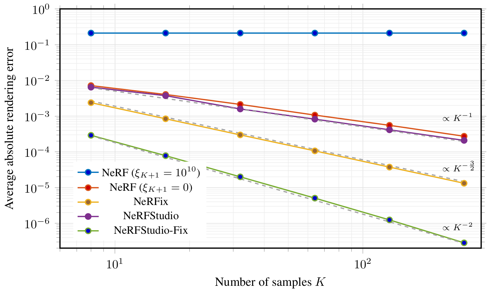

# NeRFix: fixing subtle mistakes in the quadrature of the NeRF volumetric integral

Neural Radiance Fields (NeRFs) are popular models using MLPs for continuous volumetric representations, which render novel views by means of numerical quadrature of the volumetric integral. Despite the widespread usage of NeRFs, we report subtle mistakes in their quadrature rule which have gone unnoticed for many years. In particular, we highlight mistakes present in both the original NeRF paper and its implementation as well as in the mainstream NeRFStudio implementation. We provide a theoretical analysis of rendering error bounds for NeRF and we use it to show suboptimal convergence rates in the presence of the aforementioned mistakes. We introduce minimal fixes that recover the expected convergence orders with no complexity overhead. Finally, while fixing the quadrature scheme is mostly a matter of theoretical correctness, we also provide experimental evidence that modest improvements in image quality are achieved on standard benchmarks.

**Luca Savant Aira, Diego Valsesia, Enrico Magli** · Politecnico di Torino · NeurIPS 2026

[Paper](https://neurips.cc/virtual/2026/loc/paris/poster/153568) · [Project page](https://ipllab-polito.github.io/nerfix/)

## Lay summary

Deep learning can transform a collection of photographs into a realistic three-dimensional representation of a scene, allowing us to view it from perspectives that were never actually captured by a camera. A widely used technique for this purpose is known as "Neural Radiance Fields" (NeRF). To generate new images, this method estimates how light and color vary along the path from each point in the scene toward the camera. In this paper, we demonstrate that two commonly used implementations of this technique contain subtle mathematical errors that have gone unnoticed for years. Although these flaws do not prevent the systems from producing convincing images, they introduce inaccuracies that could be avoided. We identify the causes of these errors and propose simple corrections that make the calculations more precise, without requiring additional computational power or altering the architecture of the NeRF. We prove mathematically that our adjustments improve accuracy and confirm this through experiments, which also show a modest but consistent improvement in image quality. Our findings highlight how re-examining seemingly minor details in well-established artificial intelligence methods can lead to more reliable results, at no additional computational cost.

## Reproduce Paper Results

This release reproduces all five curves. No GPU, CUDA, dataset, or pretrained weights are required. The environment pins CPU TensorFlow and PyTorch; tested on Linux x86-64.

```bash
git clone --recurse-submodules https://github.com/IPLLab-PoliTO/nerfix.git
cd nerfix
conda env create -f environment.yml
conda activate nerfix
python nerfix.py --check
python nerfix.py
```

For an existing checkout, run `git submodule update --init --recursive` and `conda env update -f environment.yml`.

The experiment evaluates each method at 19 approximately logarithmically spaced sample counts K, from 4 to 256. For each method and K, it repeatedly renders the same analytic ray with fresh random samples and averages the resulting errors. The sample-count grid is defined in `nerfix.py`; the following flags control the run:

- `--trials` (default: `10000`): number of repeated renders for each method and K. More trials give a more stable estimate of the mean absolute and RMS errors, at the cost of a longer run.
- `--seed` (default: `0`): controls the random sampling. Reusing the same seed, settings, and environment reproduces the same measurements.
- `--batch-size` (default: `1000`): number of trials processed together. Smaller batches reduce memory use; the default processes 10 batches per method and K. Changing this value also changes how random samples are assigned, so individual measurements may differ even with the same seed.
- `--fit-min` (default: `16`): smallest K included when fitting the convergence equations and the offsets of the dashed reference lines. All 19 sample counts are still measured and plotted; by default, only points with K >= 16 contribute to these fits.
- `--output` (default: `results/figure3`): directory where plots, measurements, and run settings are saved.
- `--check`: runs the numerical validation checks and exits without generating the figure.

Outputs in `results/figure3/`: PNG plot, `errors.csv` with mean absolute and RMS errors, and `metadata.json` with settings, versions, commits, and fitted equations. Measurements appear as unconnected points. Dashed reference rates have regressed offsets and labels on the graph.


The output should be something like:


## Code

- [`nerf_adapter.py`](nerf_adapter.py): loads bmild/nerf, shadows `render_rays`, and implements the original, zero-tail, and NeRFix variants.
- [`nerfstudio_adapter.py`](nerfstudio_adapter.py): loads NeRFStudio and shadows `SpacedSampler.generate_ray_samples` to restore the near/far endpoints while retaining interior boundaries.
- [`nerfix.py`](nerfix.py): runs both adapters, measures errors, fits power laws, and generates the plot.

Both adapters expose `load`, `configure`, `set_seed`, `use_method`, `render_batch`, and `self_check`. Function shadows are scoped with context managers and restored on exit. Upstream files remain unchanged.

| Submodule | Pinned commit |
| --- | --- |
| [bmild/nerf](third_party/nerf) | `14c55567a6d0fbd75d3fd12b0411f98160ba3237` |
| [nerfstudio-project/nerfstudio](third_party/nerfstudio) | `50e0e3c70c775e89333256213363badbf074f29d` |

Both revisions are checked at startup. `--check` verifies upstream agreement, constant-density integration, midpoint convergence, endpoint coverage, unchanged interior boundaries, inverse-depth mapping, and function restoration.

## Experiment details

All variants use float64 and the analytic field rho(x) = cos(pi x / 2), constant color 1/2, and black background on [0, 1]. The exact intensity is `(1 - exp(-2/pi)) / 2`.

For NeRF, K counts field evaluations; for NeRFStudio, K counts jittered boundaries with K-1 midpoint evaluations, following Eqs. (28)-(30). The upstream endpoint half-cell jitter is retained. The paper's `xi_(K+1) = 0` curve is interpreted as zero terminal distance, omitting the last contribution; a literal zero coordinate would give a negative width.

Expected convergence orders are 0 (NeRF infinite tail), 1 (zero tail), 3/2 (NeRFix), 1 (NeRFStudio), and 2 (NeRFStudio-Fix). The figure plots mean absolute error; RMS error is saved separately. Table 1 training experiments and hierarchical sampling are outside this release.

## License and citation

Our code is [MIT licensed](LICENSE), including attribution for code derived from bmild/nerf. The unmodified submodules retain their [MIT](third_party/nerf/LICENSE) and [Apache-2.0](third_party/nerfstudio/LICENSE) licenses.

```bibtex
@inproceedings{savantaira2026nerfix,
  title={NeRFix: fixing subtle mistakes in the quadrature of the {NeRF} volumetric integral},
  author={Savant Aira, Luca and Valsesia, Diego and Magli, Enrico},
  booktitle={Advances in Neural Information Processing Systems},
  year={2026}
}
```
